# TraceCause

### Investigate service failures through an evidence-backed knowledge graph.

I built TraceCause to investigate service failures through a knowledge graph that
connects distributed traces with deployments, software versions, configuration
changes, runtime processes, hosts, ownership and earlier incidents. I can choose
a symptom and a point in time, follow observed dependencies, inspect what
changed, and open the original evidence behind each result.

I run it as a complete local application: a React investigation workspace,
FastAPI and durable workers, PostgreSQL, Neo4j, retrieval and ranking models,
and optional local Qwen generation. Docker Compose initializes the entire stack.

**[Run locally](#run-the-complete-application)** ·
**[Knowledge graph](#what-the-knowledge-graph-does)** ·
**[Architecture](#architecture)** ·
**[AI and models](#where-ai-is-used)** ·
**[Evaluation](#evaluation-and-reproducibility)** ·
**[Documentation](#documentation)**

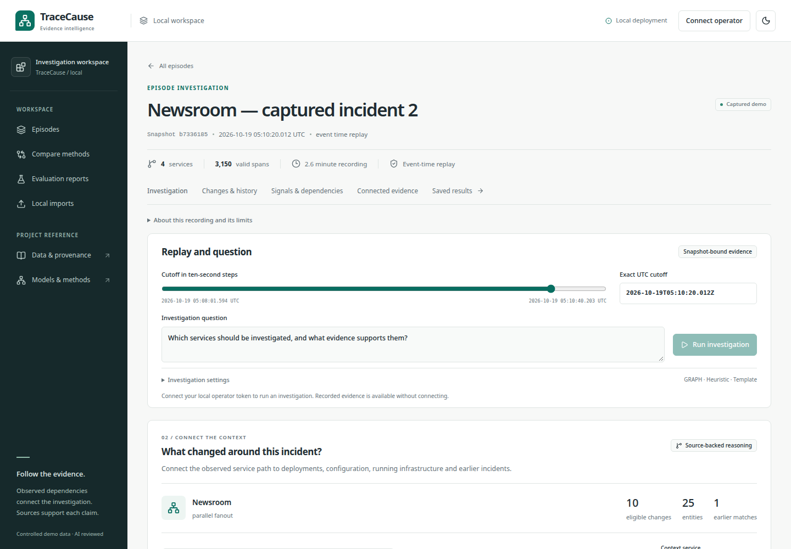

**I recorded these from the running Docker application:**
[operational walkthrough](docs/assets/operational/tracecause-operational-demo.webm) ·
[asynchronous message flow](docs/assets/operational/tracecause-message-flow-demo.webm) ·
[local Qwen investigation and export](docs/assets/operational/tracecause-live-ai-demo.webm).
My [capture manifest](docs/assets/operational/manifest.json) records file hashes,
episode scopes, source-open checks, browser errors and responsive accessibility
results. These are recordings of actual API and browser behavior, not mockups.

## An investigation you can inspect

I designed the investigation around a common trap: a failed checkout can coincide
with a checkout deployment while the observed degradation begins farther
downstream. The workspace puts competing leads and their evidence in one place:

| Task | What the application returns |
|---|---|
| Follow the symptom | Directed service calls and separately typed asynchronous handoffs, with trace support |
| Inspect changes | Deployment and configuration receipts joined to their service, version and runtime |
| Compare timing | Changes before, within or after the first degraded measurement bucket |
| Examine competing explanations | Healthy, disconnected and later changes alongside review leads |
| Compare an earlier incident | Similarity components, state differences and sources scoped to each episode |
| Check the source | Original receipt, span pair, measurement or exact authored excerpt |
| Write an investigation | Deterministic reports or local AI selection of verified facts, with saved results and exports |

I treat review order as a diagnostic heuristic. Dependencies, temporal
associations and similar incidents do not establish causality. I do not use
TraceCause to remediate systems automatically.

## Run the complete application

From the repository root, with **Docker Engine and Docker Compose** installed:

```sh
docker compose -f compose.full.yaml up --build -d --wait --wait-timeout 2400
```

Open **[http://127.0.0.1:14000](http://127.0.0.1:14000)**.
No host Python, Node, database or model installation is required for this path.

On the first start, Compose builds the application, creates persistent credentials, migrates
both databases, downloads and verifies MiniLM and Qwen, registers the bundled
ranker, and imports the demonstration data. Models and databases persist across
restarts. I included six actual local captures across three
applications, alongside the original synthetic/runbook demo.

```sh
# First-start progress
docker compose -f compose.full.yaml logs -f models migrate seed

# Services and initialization jobs
docker compose -f compose.full.yaml ps --all

# Stop while retaining data, credentials and model caches
docker compose -f compose.full.yaml stop
```

Six services remain running: web, API, worker, PostgreSQL, Neo4j and Ollama.
The four initialization jobs—bootstrap, migrate, models and seed—finish with
`Exited (0)`. Initialization failures block dependent services.

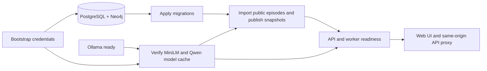

I made the bootstrap jobs idempotent. Database rows, immutable source artifacts,
published snapshots, saved investigations, credentials and model files use named
volumes. A restart does not retrain a model or replace an existing snapshot.

**Planning allowance:** 12–16 GiB available RAM and 25–40 GB disk for the CPU
stack, images, models and captures. Qwen weights are approximately 2.5 GB. These
are capacity estimates, not measured minimums. First startup and CPU inference
depend on the host. The verified deployment profile is Linux/amd64; no GPU is
required.

Only the frontend port is published, on loopback. See the
[full Docker guide](docs/DOCKER_FULL_STACK.md) for resource limits, port overrides
and startup troubleshooting, and [operations](docs/OPERATIONS.md) for backups,
TLS and the separate read-only release profile.

### First walkthrough

1. In **Incident library**, open Parcel Shop, Newsroom or Media Works. Each captured
   episode starts with a useful replay cursor and symptom from its public index.
2. Under **What changed around this incident?**, open **Change analysis**. Follow
   a review lead's dependencies and select **Inspect change record** or
   **Inspect observed signal**.
3. Open **System graph** to connect services with versions, deployments, runtimes,
   hosts and teams. **Relationship table** provides the same relationships in a
   readable list.
4. Move the cutoff under **Replay and question** to inspect earlier eligible
   facts. Ten-second measurement buckets leave same-bucket ordering uncertain.
5. In an application's second episode, open **Previous incidents**, then compare
   **Earlier source** and **Current source** for a state difference.
6. To submit an investigation, retrieve the locally generated operator token:

   ```sh
   docker compose -f compose.full.yaml exec -T api cat /run/secrets/operator_token
   ```

   Select **Connect operator**, paste it, then choose `template` or `ollama` under
   **Investigation settings**. Opening a saved report does not invoke a model again.

### See the evidence path

| Inspect a change | Follow the graph |
|---|---|
| 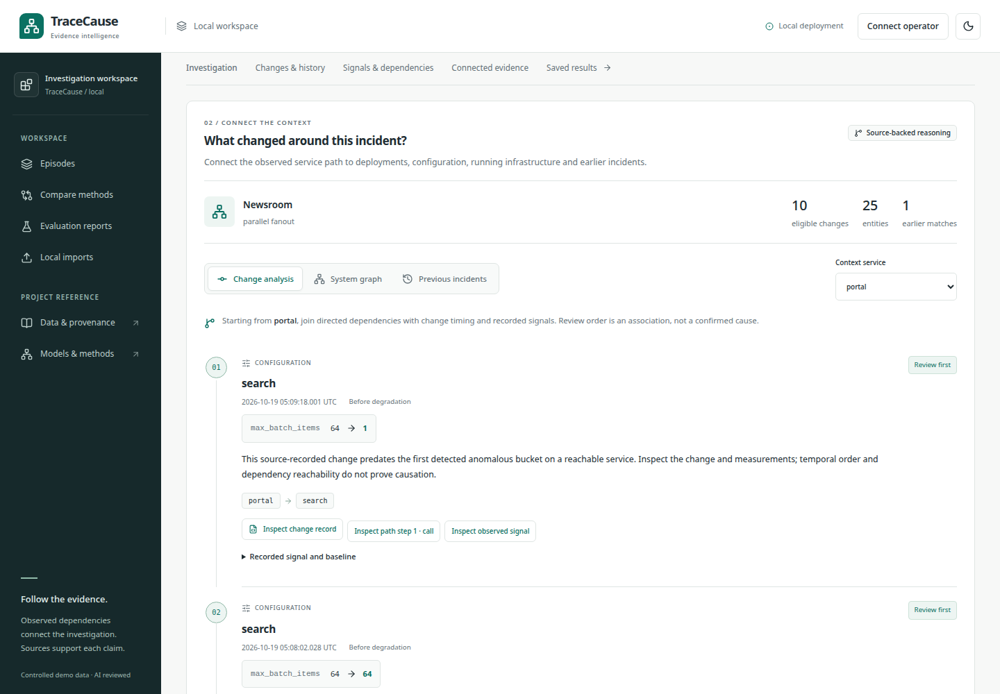 | 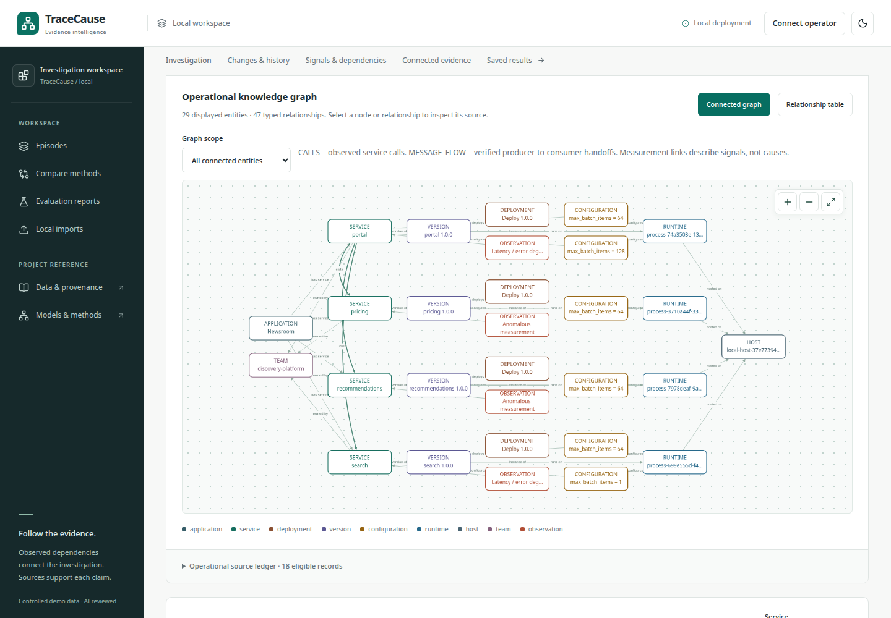 |
| [Open the change view](docs/assets/operational/change-reasoning.png) | [Open the graph view](docs/assets/operational/operational-knowledge-graph.png) |

| Compare an earlier incident | Verify an asynchronous handoff |
|---|---|
| 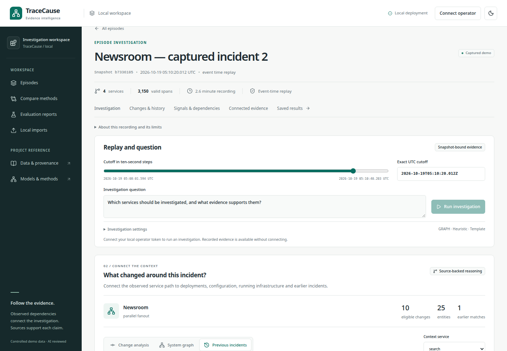 | 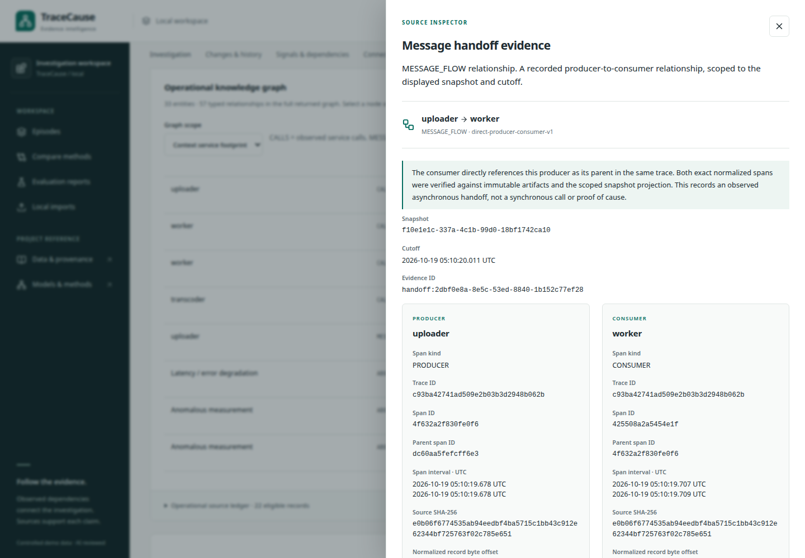 |
| [Open the history view](docs/assets/operational/historical-comparison.png) | [Open the handoff evidence](docs/assets/operational/message-handoff-evidence.png) |

The same investigation is usable at [phone](docs/assets/operational/history-360.png)
and [tablet](docs/assets/operational/history-768.png) widths and in
[dark mode](docs/assets/operational/operational-graph-dark.png). The
[live AI findings](docs/assets/operational/ai-investigation-findings.png)
show a real saved Qwen result with cited evidence.

| More of the live workflow | What I inspect there |
|---|---|
| [Incident library](docs/assets/operational/episode-library.png) | Captured applications, episode identity and a useful default replay cursor |
| [Service and deployment footprint](docs/assets/operational/service-deployment-footprint.png) | Versions, runtimes, hosts and ownership tied to services |
| [Relationship table](docs/assets/operational/operational-relationships.png) | A readable alternative to the graph canvas, including relation types |
| [Operational receipt](docs/assets/operational/operational-source.png) | Exact changed configuration or deployment record |
| [Measured signal source](docs/assets/operational/measured-signal-source.png) | Baseline and changed observation buckets behind an onset claim |
| [Asynchronous graph](docs/assets/operational/asynchronous-knowledge-graph.png) | Message handoff alongside separately typed calls |
| [AI request](docs/assets/operational/ai-investigation-request.png) | Model and investigation controls before the job runs |
| [Cited AI evidence](docs/assets/operational/ai-cited-evidence.png) | A generated report linked to eligible facts and source records |
| [Saved result export](docs/assets/operational/ai-saved-result-export.png) | The persisted result and downloadable JSON |

## What the knowledge graph does

I use the graph to join identities from different sources. Deployment receipts identify
versions and runtimes; traces establish observed service dependencies; measurements
show degradation; earlier snapshots supply historical context. These relationships
support queries with inspectable paths.

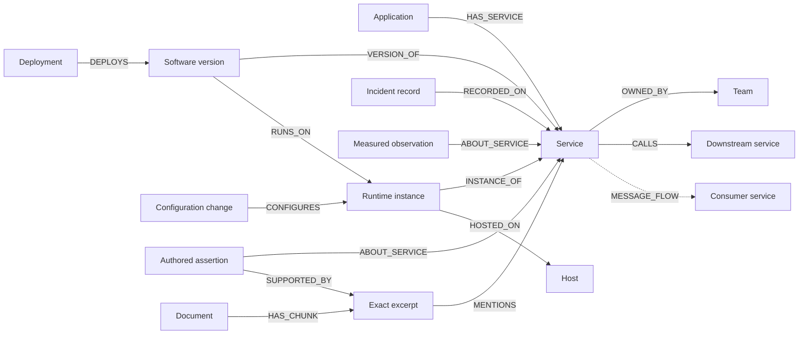

These are the relationship types I support; every source need not contain every
entity. Hosts and runtime IDs come from recorded process metadata. Teams are
operator-assigned. Authored historical claims remain distinct from telemetry.

### Three useful queries

**What changed along the failing service's dependencies?** Follow at most three
directed steps from the symptom, join eligible deployment/configuration events,
and compare them with source-backed latency/error onset. Among earlier changes,
services with no further observed degraded dependencies are reviewed before
upstream services with degraded descendants. Those descendant measurements and
paths are exposed, alongside conflicting contextual changes.

**How does this differ from an earlier incident?** Compare completed episodes in
the same application and environment using service, typed dependency and anomaly
overlap. Inspect latest observed version, configuration, host and ownership
differences. Missing state means unknown. Each side retains its original episode,
immutable snapshot and evidence cutoff.

**Which documented checks apply downstream?** Traverse observed calls to
source-verified `SUGGESTS_CHECK` assertions and exact Markdown quotes. A MiniShop
`checkout` runbook cannot enter a new Parcel Shop snapshot through the shared
short name. Operational runbooks must declare a matching namespace/environment;
the current operational captures do not inherit unrelated demo runbooks.

### Asynchronous edges retain their meaning

Media Works records a producer on `uploader` and its directly parented consumer
on `worker`. This produces `uploader → worker` as `MESSAGE_FLOW`. A separate HTTP
call to `broker` remains `CALLS`; no `broker → worker` call is fabricated.
Producer and consumer spans need not overlap. Each handoff opens the exact span
pair, normalized artifact hashes and source offsets.

[Operational architecture](docs/architecture/operational-graph.md) ·
[Reasoning rules and bounds](docs/evaluation/OPERATIONAL_REASONING.md) ·
[Authored knowledge queries](docs/KNOWLEDGE_GRAPH.md)

## Architecture

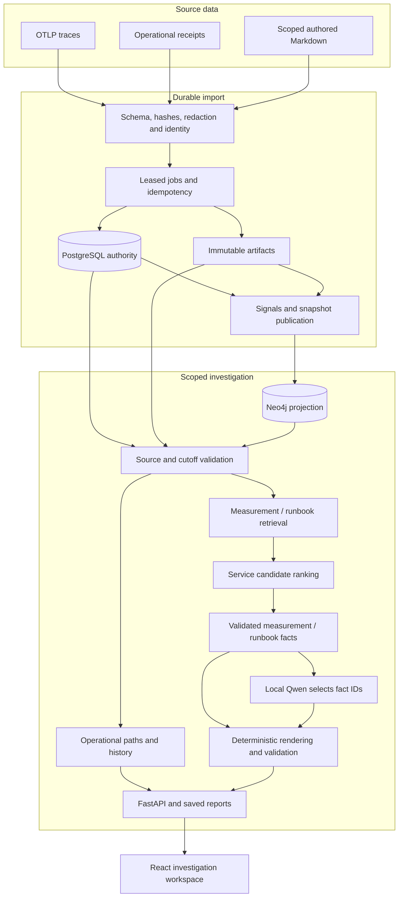

Two coordinated workflows share source infrastructure: deterministic operational
change/history queries, and the existing measurement/runbook investigation
pipeline. Deployment receipts and historical comparisons are not sent to Qwen as
new narrative facts. The original investigation ranker is a separate component.

| Component | Responsibility |
|---|---|
| React, TypeScript, Cytoscape, Recharts | Workspace, graph/table views, timelines, source drawers and exports |
| FastAPI + Pydantic | Typed contracts, scoped reads and authenticated operator actions |
| PostgreSQL + SQLAlchemy/Alembic | Source metadata, jobs, snapshots, model registry and saved results |
| Neo4j | Rebuildable typed graph projection and bounded relationship queries |
| Artifact store | Hash-addressed source bytes with exact locators |
| Durable worker | Imports, signals, graph publication and investigation execution |
| MiniLM + scikit-learn | Dense retrieval and optional learned service ranking |
| Ollama + Qwen | Constrained local fact selection |
| Caddy + Docker Compose | Frontend serving, same-origin proxy and complete startup |

### From captured bytes to an answer

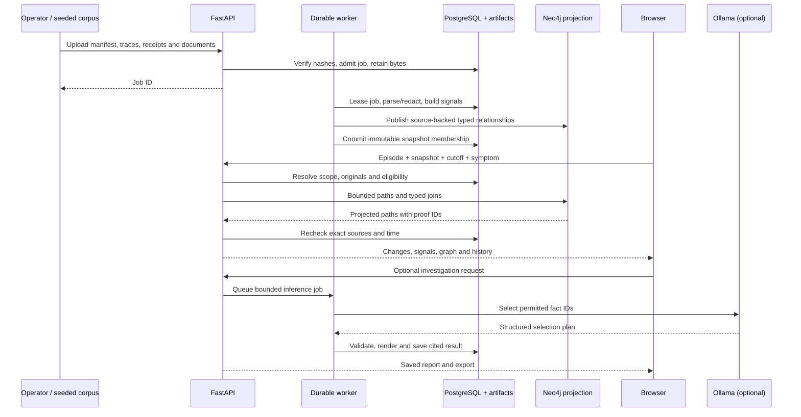

An operator upload is authenticated and idempotent. Reads are scoped to an
episode, immutable snapshot, replay mode and cutoff. The LLM step is optional;
the graph, change analysis, history and source inspector work without it.

### A request's evidence boundary

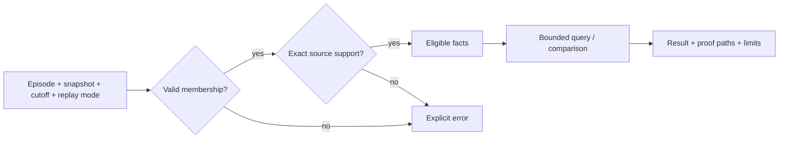

- **Two clocks:** event time describes when something happened; availability time
  describes when it became known. Available-time replay excludes later receipts.
  An earlier incident's completed event-time view is eligible only after its
  sources were known at the current knowledge cutoff.
- **Immutable membership:** snapshots pin source membership and prior snapshots.
  Imports and new projection policies publish new snapshots; old results retain
  their original evidence.
- **Verified projections:** graph facts are checked against PostgreSQL and source
  artifacts. Altered, orphaned or cross-scope proof structures fail validation.
  Neo4j is rebuildable and is not the source of truth.
- **Offline controls:** expected targets and fault-injection controls are excluded
  from runtime images and retrieval. Evaluation sends ordinary public API
  parameters and scores the responses outside the application.

## Where AI is used

I keep operational change/history queries deterministic; they require no LLM or
trained model. The separate investigation pipeline offers:

| Component | Actual role | Boundary |
|---|---|---|
| `all-MiniLM-L6-v2` | Evidence embeddings for dense/hybrid retrieval | Pinned revision, CPU inference, bounded context |
| Heuristic ranker | Default service ordering from measured signals and topology | Review scores, not causal probabilities |
| `candidate-logistic-v4` | Optional logistic regression with imputation, scaling and graph-relative features | Experimental, explicitly selected |
| Qwen3 4B Instruct, Q4_K_M | Permitted fact IDs and narrative focus through a structured plan | No graph mutation, Cypher or action execution |

Qwen receives a bounded catalog of validated facts. Its plan is checked; code
renders exact values and citations, then independently validates them against
eligible evidence. Generation origin is recorded. Invalid or unavailable
generation can visibly fall back to a template. Constrained plans reduce the
factual surface available to the model; fact selection can still be unhelpful.

I fitted V4 on **50 identifiable training episodes / 270 candidate rows**:
40 synthetic episodes and ten earlier MiniShop captures. These are distinct from
the six new operational captures. Development candidate Hit@1 improved from 0/5
to 5/5 on captured cases while declining from 10/10 to 8/10 on synthetic cases.
I kept heuristic ranking as the default. Development selection is not an
independent final test; the frozen v3 artifacts and results remain intact.

Startup loads models for inference; it does not train or rerun benchmarks. No
paid model API is required.

In the final browser run I used actual local Qwen: **3 hypotheses, 5 cited
sources, no fallback**, 36.562 seconds of generation and 50.361 seconds through
the pipeline before publication. I observed the queued/running/success
states, opened a source successfully, and verified that the downloaded JSON
matched the saved API result. This is one observed CPU run, not a latency benchmark.

[Model card](docs/MODEL_CARD.md) · [Local generation](docs/LOCAL_GENERATION.md) ·
[Reliability engineering](docs/phase-reports/reliability.md)

## Real captures included in the repository

I captured the operational lab by running local subprocesses, HTTP requests and
queued work. It records original timestamps, trace parents, release artifacts, configuration
writes and runtime metadata: **28,935 spans and 129 operational events across six
episodes**, captured on 19 October 2026.

| Application | Observed topology | Episodes |
|---|---|---:|
| Parcel Shop | `checkout → orders → ledger` | 2 |
| Newsroom | `portal → search / pricing / recommendations` | 2 |
| Media Works | HTTP ingress/broker, producer → consumer handoff, then `worker → transcoder → object-store` | 2 |

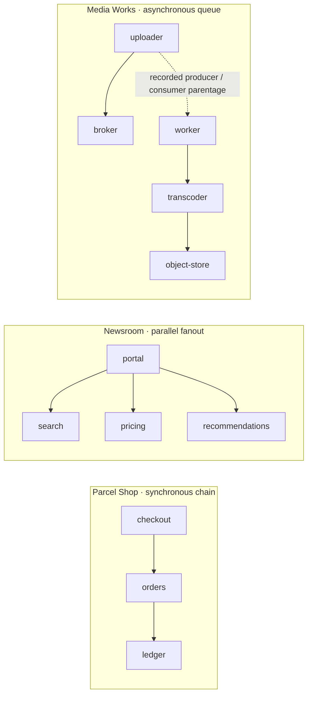

Solid lines summarize observed request dependencies. The dotted Media Works
line is a distinct, source-verified `MESSAGE_FLOW`; it does not imply a direct
HTTP call through the broker.

Each application has one release replacement and one configuration change, with
a newer benign entry-service change as a competing lead. Each run has 70 seconds
of baseline, 60 seconds of changed workload and 20 seconds of recovery. These
are small controlled applications on one host, with operator-assigned teams.
They are not production telemetry or an infrastructure discovery system.

I publish sources and manifests in [`data/operational-lab`](data/operational-lab).
The [data card](docs/DATA_CARD.md#operational-knowledge-graph-track-october-2026)
explains capture, provenance, evaluation use and limits.
[Minimal reference labels](docs/evaluation/operational/labels-manifest.json) are
published separately for offline evaluation and excluded from the Docker build
context and runtime. Earlier MiniShop raw
training/review bundles are separate local artifacts, absent from a clean clone;
their sanitized aggregate results and trained model artifacts are available.

## Evaluation and reproducibility

### Operational graph comparison

I compare graph/time reasoning with chronological ordering,
direct-service lookup, and separate graph/time ablations on the same eligible
change pool and output budget. It measures candidate recall separately from
top-1 event/service selection, audits citations, checks future evidence exclusion,
and records historical state differences.

| Method | Selection rule within the same eligible change pool |
|---|---|
| Graph + temporal | Changes marked `review_first` by bounded dependency paths and measured onset timing |
| Chronological | Newest eligible changes first |
| Direct service | Newest eligible changes on the symptom service only |
| Without graph | Local measured degradation before onset, without dependency paths |
| Without time | Graph-connected degraded changes without the onset-order condition |

I report top-one event and service identity separately from recall at three.
The three alternatives and two ablations use the same three-result output budget;
the evaluator opens every cited source through the public API and rejects future
events. The reference event identity comes from a private capture control and
never enters the runtime request.

I designed the policy with knowledge of these controlled scenarios and froze it
before the first API evaluation. Six cases do not establish generalization.
With only one prior incident per application, historical comparison demonstrates
retrieval and differences, not archive-scale search quality. Pre-change replay
abstentions may have no eligible analysis signals and do not estimate healthy
false-positive rates.

| Method | Changed event top 1 / 6 | Changed service top 1 / 6 | Reference event in top 3 / 6 | Pre-change abstentions / 6 |
|---|---:|---:|---:|---:|
| Graph + temporal | **6** | **6** | **6** | **6** |
| Chronological | 0 | 0 | 6 | 0 |
| Direct service | 0 | 0 | 0 | 0 |
| Without graph | 2 | 2 | 6 | 6 |
| Without time | **6** | **6** | **6** | **6** |

I measured **6/6 reference changes in the candidate pool and review set**, **0
future-event violations** and **1,021/1,021 cited source requests resolved** across
the 12 changed/pre-change queries. Each second episode retrieved its one earlier
incident and exposed three state differences at the changed cutoff. The
chronological method placed a newer benign change first in every changed case.
Removing graph paths reduced first-place event identity to 2/6. Removing the
timing rule did **not** reduce first-place identity in this corpus; I do not claim
that this run demonstrates an incremental ranking gain from timing. The six
pre-change cutoffs can lack eligible degraded signals, so 6/6 abstentions are not
a general false-positive estimate.

I publish the [full per-case result and citation audit](docs/evaluation/operational/results.json),
[frozen input hashes and cutoffs](docs/evaluation/operational/frozen-inputs.json),
and [evaluation protocol](docs/evaluation/operational/protocol.json). These cases
are small, repeated, controlled local workloads designed with knowledge of their
interventions. They are a reproducible engineering comparison, not an independent
production accuracy result.

[Protocol, rules and ablations](docs/evaluation/OPERATIONAL_REASONING.md)

### Existing research remains separate

I also retain the original frozen comparison of 120 synthetic episodes and 24 controlled
MiniShop captures. It includes negative transfer, abstention and ambiguous cases;
I have not rewritten those results to imply improvement from subsequent runtime
repairs. Captured test target ranking is undefined where no unique target is
established. See [complete results](docs/EVALUATION_RESULTS.md),
[data card](docs/DATA_CARD.md) and [model card](docs/MODEL_CARD.md).

### Reproduce capture and audit

With the developer environment installed, I use new output directories:

```sh
uv run --locked --group ml python -m scripts.capture.operational_lab \
  --output data/operational-lab-new \
  --private reports/operational-lab-new/private

uv run --locked --group ml python -m scripts.capture.operational_lab_audit \
  --root data/operational-lab-new \
  --output reports/operational-lab-new/source-audit.json
```

New captures have new timestamps and identities. Import their bundles through
the operator upload flow before evaluating them; Docker seeds the bundled public
index. To evaluate the exact bundled corpus using its published offline labels:

```sh
uv run --locked --group ml python -m scripts.evaluation.operational_capture \
  --base-url http://127.0.0.1:14000 \
  --protocol docs/evaluation/operational/protocol.json \
  --truth-root docs/evaluation/operational/labels \
  --output reports/operational-lab/evaluation-new
```

For a new capture, pass `--index` and `--truth-root` for its new public index and
private receipts. Evaluation refuses to overwrite output and retains frozen
hashes, complete API responses, per-case metrics and citation audits. Published
labels contain only the scoring fields and source provenance; their file hashes
differ from the original private receipts used in the first run, as recorded in
the label manifest. Their expected event identities are unchanged.

## Development and verification

I use Python 3.12, Node 24 and locked Python/npm dependencies. I pin
**uv 0.11.19** and verify tool versions; the Docker images
already supply them. A host development environment is needed only for editing
and verification:

```sh
uv sync --locked --group ml --python 3.12
npm ci --prefix apps/web
npx --prefix apps/web playwright install chromium
cp .env.example .env
make secrets
make up
uv run --locked --group ml python -m scripts.ci.prefetch --embeddings
UV_NO_SYNC=1 make release-check
```

`release-check` runs Python/frontend lint and type checks, generated-contract
checks, unit tests, real PostgreSQL/Neo4j integration, MiniLM execution, fixture
evaluation, API/worker browser workflows and security scans. Chromium needs its
standard system libraries; CI installs them through Playwright. Browser tests use
ports 15173/18080. The full Docker application uses separate volumes and a separate
Compose project.

I also check source mismatch, scope/cutoff violations, late
historical receipts, asynchronous projection tampering, idempotent projection,
document scope and graph/time ablation semantics.

For this final local build, I passed **406 Python unit/contract tests, 11
frontend unit tests, 51 real PostgreSQL/Neo4j/API integration tests**, lint,
type checks, generated contracts and the production frontend build. The live
browser recordings passed responsive and accessibility checks at 360, 768 and
1440 pixels, including a dark graph and exact asynchronous handoff inspection.
The final advisory and secret scans all passed after updating the pinned
`certifi` dependency.

I also tested the complete Docker lifecycle. After a synthetic import, stopping,
rebuilding and starting the stack preserved the operator credential, **15 active
snapshots and 21 saved investigations**. All six runtime services were healthy;
the four initialization jobs exited successfully. I compared the running API and
worker against **94 Python source files** and the served frontend against **17
built files**. An isolated fresh-install/restore drill separately rebuilt seven
snapshots from 97 verified artifacts, reopened 195 scoped source proofs on each
side, and preserved its before/after application state byte for byte. That drill
used an earlier image before the final query/UI repairs; the final-image lifecycle
and source audit are separate checks.

The [release evidence and retained failures](docs/phase-reports/operational-capstone.md),
[live media manifest](docs/assets/operational/manifest.json),
[completed evaluation](docs/evaluation/operational/results.json) and
[known limits](docs/KNOWN_ISSUES.md) record the precise scope of these claims.

### Repository map

```text
apps/web/                     React workspace and browser tests
src/tracecause/
  api/                        HTTP contracts, scoped reads and operator routes
  ingestion/                  OTLP parsing, identity, redaction and source allowlists
  documents/                  Exact excerpts, scoped links and authored assertions
  graph/                      Snapshots, verification and bounded queries
  operational/                Operational entities, handoffs and change/history reasoning
  telemetry/                  Windowed observations and baseline signals
  retrieval/                  Lexical, dense, hybrid and graph retrieval
  ranking/                    Model features, fitting and JSON inference artifacts
  investigation/              Ranking, fact plans, rendering and validation
  jobs/                       Durable leases, retries and publication
  storage/                    PostgreSQL and content-addressed artifacts
data/operational-lab/          Public captured sources and manifests
models/                       Frozen and experimental ranker artifacts
scripts/capture/               Real workload capture and source audits
scripts/evaluation/            Offline comparisons and reports
tests/                        Unit, contract, database, model and security checks
docs/                         Architecture, decisions, operations and evidence
compose.full.yaml             Entire local application, including AI
```

## API surface

| Endpoint | Purpose |
|---|---|
| `GET /api/v1/episodes` | Imported episode catalog |
| `GET /api/v1/graph` | Eligible synchronous service dependencies |
| `GET /api/v1/operations` | Operational entities, typed dependencies, change review and history |
| `GET /api/v1/operations/evidence/{id}` | Source-backed operational receipt |
| `GET /api/v1/operations/handoffs/{id}` | Exact producer/consumer proof |
| `GET /api/v1/knowledge` | Services, measurements, documents, excerpts and assertions |
| `GET /api/v1/knowledge/checks` | Directed paths to authored checks |
| `GET /api/v1/evidence/{id}` | Scoped telemetry or document evidence |
| `POST /api/v1/imports` | Authenticated, hash-validated multipart import |
| `POST /api/v1/investigations` | Authenticated durable investigation job |
| `GET /openapi.json` | Machine-readable API contract |

Graph and evidence requests require explicit episode/snapshot/time scope. Mutation
routes require the operator token and idempotency key where specified. Eligibility
is enforced by the server. See [API usage](docs/API_LOCAL.md) for request formats.

## Design limits

- Local, single-operator research application. Public hosting, multi-tenant
  authorization and independent production validation are not supplied.
- Bounded three-hop temporal reasoning. Concurrent failures, incomplete tracing
  and noisy baselines can alter ordering. Scores do not estimate causal probability.
- Async support covers directly linked producer/consumer parents in one trace;
  arbitrary span-link chains and broker delivery guarantees are not inferred.
- Three small captured applications, two episodes each, one host and assigned
  ownership do not establish broad incident generalization.
- Degradation requires enough populated baseline measurements. Volume change
  alone does not establish failure; same-bucket temporal ordering stays unresolved.
- Local Qwen can select unhelpful facts or fail generation. Fallback and origin
  remain visible. Models cannot execute checks or create authoritative graph edges.
- I used AI assistance during development and review. I identify AI-reviewed
  evaluation decisions as such; they are not independent human adjudication.

## Documentation

| Read this | For |
|---|---|
| [Full Docker stack](docs/DOCKER_FULL_STACK.md) | Startup, tokens, resources and persistent data |
| [Operational architecture](docs/architecture/operational-graph.md) | Entities, source contracts and graph guarantees |
| [Operational reasoning](docs/evaluation/OPERATIONAL_REASONING.md) | Change order, history, controls and ablations |
| [Knowledge graph](docs/KNOWLEDGE_GRAPH.md) | Authored evidence and path queries |
| [Model card](docs/MODEL_CARD.md) | Training data, tradeoffs and inference boundaries |
| [Evaluation results](docs/EVALUATION_RESULTS.md) | Frozen denominators and negative findings |
| [API](docs/API_LOCAL.md) | Uploads, jobs and evidence requests |
| [Recovery](docs/RECOVERY.md) / [Security](docs/SECURITY.md) | Backups, rebuilds and threat boundaries |
| [CI](docs/CI.md) / [Release audit](docs/RELEASE_AUDIT.md) | Verification and recorded release evidence |
| [Implementation status](docs/IMPLEMENTATION_STATUS.md) | Current checkpoint and remaining limits |

## License and attribution

Application code is **Apache-2.0**. Models, dependencies, container images and
original planning material retain their own terms; see the
[third-party inventory](docs/THIRD_PARTY.md). No production adoption or independent
authorship of models and dependencies is claimed.
