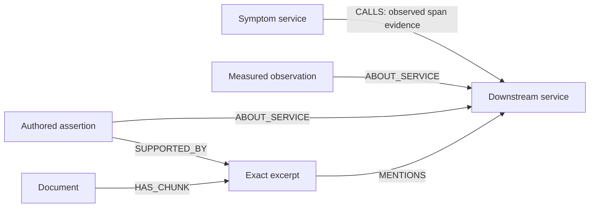
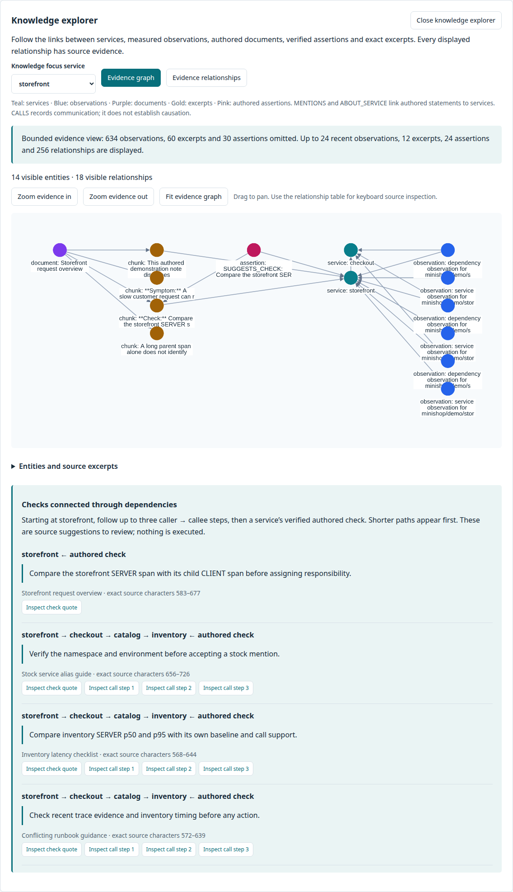

# How TraceCause uses its knowledge graph

TraceCause now also includes source-backed deployment, version, configuration,
runtime, host, team and incident entities; typed asynchronous handoffs; temporal
change reasoning; and pinned comparisons with prior incidents. See the
[operational architecture](architecture/operational-graph.md) for that ontology,
its three captured application topologies and exact reasoning rules. This guide
describes the complementary measurement/runbook query path.

The schema is stable; each imported episode supplies different service identities,
observations, call relationships and document membership. A published snapshot is
immutable. Changing the replay cutoff changes which supported facts are eligible.
The original MiniShop demo has a narrow vocabulary. The newer three-application
corpus broadens topology coverage, while remaining a small controlled local lab.

## A functional query

“Which documented checks relate to this service and its downstream dependencies
at this time?” The server:

1. Resolves episode, snapshot, cutoff and replay mode.
2. Validates eligible directed calls against source telemetry.
3. Re-extracts accepted mentions and typed assertions from original document bytes.
4. Verifies projected quotes, predicates, character offsets, subjects and support.
5. Follows at most three caller-to-callee hops, joining to SUGGESTS_CHECK assertions.
6. Returns each exact quote and a continuous, individually cited proof path.

A direct lookup would find only checks naming the starting service. The graph can
find a check naming a downstream service even when it never mentions the symptom
service. The controlled topology comparison measures this difference. Direction,
unambiguous entity linking and temporal eligibility affect the result; this is
more than displaying related words as nodes.

One deterministic shortest path per service is returned. Distance orders relevance;
it is not a probability or root-cause score. Checks are suggestions written in the
source, not automatically generated commands. Ambiguous mentions stay unresolved.
Historical cause assertions remain historical documentary claims.

## Where to inspect it

Open an episode → **Explore connected evidence** → choose a service. Inspect the
quoted check, each call step, and the relationship table. **Pin this cutoff** then
move forward to compare observed dependencies. Comparison uses the same snapshot
and preserves each evidence cutoff. Absence in the six-minute call window is not
proof of topology removal.

| API | Result |
|---|---|
| `GET /api/v1/graph` | Eligible observed service calls |
| `GET /api/v1/knowledge` | Bounded service/observation/document/excerpt/assertion view |
| `GET /api/v1/knowledge/checks` | Directed paths to source-verified authored checks |
| `GET /api/v1/evidence/{id}` | Authoritative scoped source excerpt |
| `GET /api/v1/operations` | Operational ontology, change proofs and pinned historical comparisons |
| `GET /api/v1/operations/evidence/{id}` | Hash-verified deployment/configuration/runtime/ownership receipt |
| `GET /api/v1/operations/handoffs/{id}` | Exact source-verified producer/consumer span pair |

The first three require `episode_id`, `snapshot_id`, `as_of` and `temporal_mode`;
the check query also requires `symptom_service_id`. Response truncation is explicit.
Contracts are generated from Pydantic into JSON Schema/OpenAPI and TypeScript.

## Relationship to AI

MiniLM provides dense retrieval; the optional learned ranker orders service
candidates using measured features, including graph-relative features. Local Qwen
selects allowed evidence facts. Server code renders exact values/citations. The
model cannot invent authoritative graph facts, issue Cypher or execute a check.
The graph query above is deterministic and auditable independently of the model.

The project does not implement probabilistic causal inference, infrastructure
asset discovery, cross-incident causal learning or an independently validated
production ontology. See [ADR 0016](adr/0016-verified-knowledge-paths.md),
[case study](CASE_STUDY.md) and the [audit](phase-reports/portfolio-readiness.md).

## Actual application capture

[Recorded controlled competency output](assets/portfolio-knowledge-competency.json).
