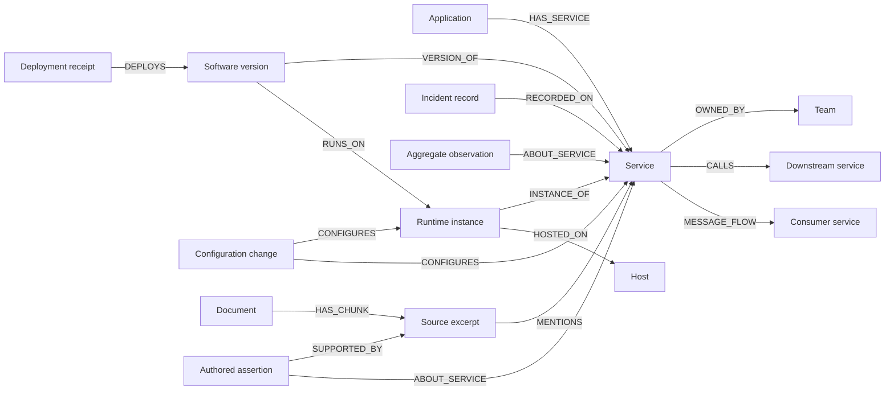
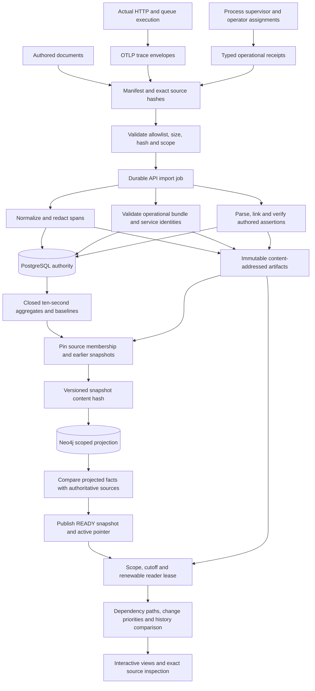
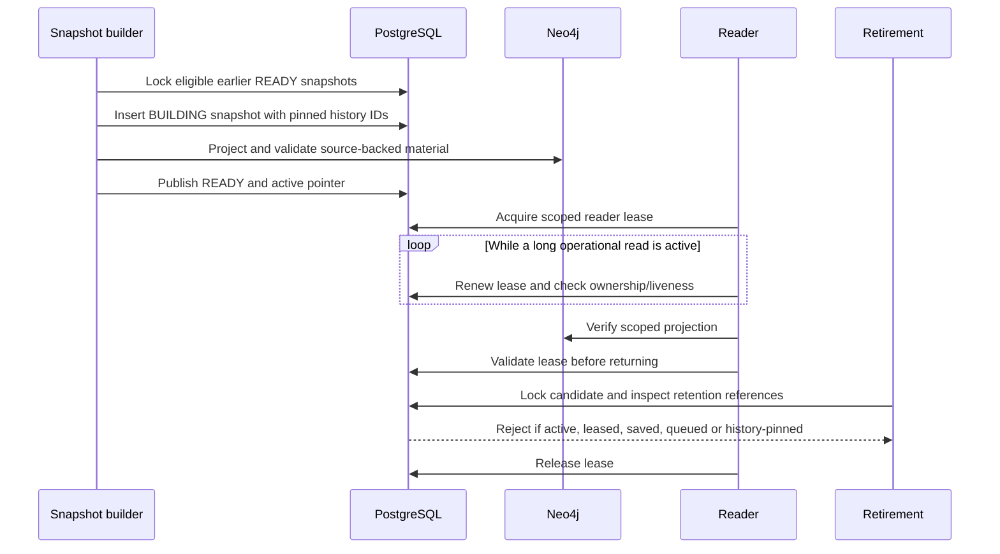

# Operational knowledge graph and historical reasoning

TraceCause connects measured service behavior to recorded deployments, software
versions, configuration changes, runtime processes, hosts, ownership and earlier
incidents. The graph supplies explicit joins and inspectable evidence paths. Its
change priorities and historical similarity are deterministic rules with stated
limits; they are not estimates of causal probability.

This document describes the implemented architecture. Release verification,
deployment checks and measured evaluation results belong in the
[operational capstone report](../phase-reports/operational-capstone.md).

## Ontology and source meaning

| Relationship family | Evidence and interpretation |
|---|---|
| Deployments, versions and runtime instances | Typed supervisor receipts record the deployed version, revision, release artifact SHA-256 and actual process identity. |
| Configuration, host and ownership | Source records describe observed configuration writes, runtime inventory and operator assignments. Repeated records are historical observations; graph presence alone does not establish current live state. |
| `CALLS` | Validated trace parentage and measured dependency observations establish an observed synchronous call relationship. |
| `MESSAGE_FLOW` | A consumer span directly references a producer span in the same trace, on a different service. This records asynchronous parentage, not an inferred broker path or delivery guarantee. |
| Observations and documents | Aggregates retain exact supporting spans. Authored assertions retain the exact source quote, character offsets, subject and supporting excerpt. |
| Historical membership | PostgreSQL snapshot metadata pins exact earlier snapshot IDs. It is a cross-snapshot comparison boundary, not an invented causal edge between incidents. |

Each operational edge has one or more `operation:<UUID>` evidence IDs. A message
edge has `handoff:<UUID>` evidence containing the exact verified producer and
consumer spans. Existing call edges cite their supporting observations. An
authored incident note is a source assertion; it does not become ground truth.

## Import, publication and query flow

The API stages only manifest-declared files. The worker imports telemetry before
operational receipts, so every operational service identity must resolve to a
service actually present in the episode's telemetry. An episode accepts at most
one operational bundle, and its source membership cannot be replaced silently.

PostgreSQL owns episodes, jobs, observations, source references and snapshot
lifecycle. Content-addressed artifacts preserve exact normalized spans and source
receipts. Neo4j is a rebuildable projection of those records. It is not a second
uncontrolled authority.

A snapshot content hash includes normalized span hashes, observation provenance,
document membership and extraction versions. Operational snapshots additionally
include the operational source hash, operational/message derivation versions and
pinned historical snapshot IDs. They also pin replay aggregation and document
scope versions. These additional fields are conditional, so the
legacy snapshot hash for an episode without operational sources is preserved.

The graph is validated before a `READY` publication changes the active pointer.
Failed construction does not replace the previous active snapshot. Operational
imports also materialize the intervening closed aggregate windows needed for
replay; a read cannot substitute a future aggregate for missing evidence at an
earlier cursor.

Operational replay version `closed-bucket-v1` uses the same closed ten-second
aggregate cursor during import and reads, including the episode's final closed
bucket. This matters because the input cursor participates in observation IDs;
an arbitrary subsecond UI cursor must not silently produce IDs absent from the
snapshot. Original span and receipt timestamps remain unchanged. Imports bound
the materialized replay to 120 cutoffs and preserve the historical bucket sources.
Startup verifies older operational projections before publishing upgraded
snapshots in chronological order. It retains the earlier immutable snapshots and
pins the upgraded earlier episode when building a later episode.

Replay modes are also pinned in snapshot membership. Every operational episode
materializes event-time aggregates. An episode with recorded availability for
every telemetry span additionally materializes distinct availability-time
aggregates at the same cutoffs, excluding sources not yet recorded. This bounds
work to 120 cutoffs per supported mode. Unknown availability is never filled in;
the API rejects an availability reasoning request when its snapshot lacks that
capability. Legacy snapshot memberships retain their original hashes.

The public capture index supplies a demonstration cursor and symptom service.
Bootstrap derives the latter from one unambiguous operational service identity
and checks it against persisted telemetry before saving UI defaults. It does not
read private evaluation targets or replace the user's explicit service choice.

## Source verification before output

Operational reads reload the registered, hash-checked bundle and reconstruct its
expected entities and relationships. Projected payloads, endpoints and scope must
match that source material. A mismatch is an error, not a successful empty result.

Message derivation verifies normalized span rows against their immutable source
artifacts, including service identity, parent ID, timestamps, status and source
locators. A direct producer/consumer pair must have consistent ordering and a
start-time separation of at most one hour. The graph's message observations and
relationships are checked against those exact pairs.

Measurements used in change reasoning must have an aggregate and populated
baseline evidence present in the requested snapshot. Those observations are then
verified through the normal source resolver. Evidence links preserve their own
episode, snapshot, cutoff and replay mode.

## Two clocks and historical replay

| Clock | Question answered | Eligibility |
|---|---|---|
| Event time | What had happened by this cursor? | Span/observation end or operational `occurred_at` must be at or before the cutoff. |
| Availability time | What information had been recorded by this cursor? | The event-time condition also holds, and recorded availability must be at or before the cutoff. Missing telemetry availability disables this replay mode. |

Historical comparison uses a completed earlier episode from the same workspace,
application and environment. Its event profile is reconstructed at that earlier
episode's end. In availability-time replay, it qualifies only when **all** of its
span and operational-source availability is recorded and no later than the
current knowledge cutoff. Unknown or future availability excludes the profile.
This permits late-arriving prior evidence once the whole prior profile is known,
without pretending that it was available when the earlier incident ended.

Historical citations therefore carry both their event-time inspection scope and
the current `knowledge_as_of` boundary. The interface opens the prior source at
the prior episode's cutoff and mode. Current operational facts continue to obey
the current replay mode. The bundled operational captures do not record telemetry
arrival times and are explicitly **event-time only**.

## Change reasoning with explicit proof paths

1. Select a symptom service and construct directed paths of at most three observed
   dependency steps. Paths may contain `CALLS` and verified `MESSAGE_FLOW` edges.
2. Consider deployment and configuration records from the preceding 24 hours.
3. Join each change to its service's eligible latency/error measurements and
   baseline. Volume deviation is displayed as context; it does not establish
   degradation for this rule.
4. Compare the recorded change time with the first detected degradation bucket.
   A change before that bucket is a review lead; one inside the ten-second bucket
   has ambiguous ordering; later and disconnected changes remain context.
5. Among preceding changes, prefer a changed service with no further observed
   degraded dependency over an upstream service with degraded descendants.
   Downstream paths and measurements explain this ordering. Recency and stable
   tie-breaks resolve otherwise equal leads.

The last step is a declared localization heuristic. Concurrent faults, missing
edges, cycles and sampling can defeat it. A terminal observed degradation is not
proof that the service caused its callers' symptoms. The response exposes change
receipts, selected-service paths, downstream paths, measured values, baseline
citations and uncertainty classifications so the user can inspect that reasoning.

## Historical comparison

Similarity combines service overlap (20%), directed dependency overlap (40%) and
measured anomaly-kind overlap (40%). Anomaly kinds are latency, errors and volume.
Unavailable components are omitted and the remaining weights normalized. These
are explicit weighted set overlaps, not learned probabilities.

Each match reports added/previous-only observed dependencies and selected state
differences: deployment version, configuration values, runtime host and ownership
team. Each side has a source citation. An unobserved value stays unknown; absence
does not imply deletion or unchanged state. The prior state is the state observed
by that episode's end, which may include recovery, rather than an automatically
aligned incident phase.

## Immutable history and reader lifecycle

Earlier snapshot IDs are selected and pinned at publication. Later imports or
active-pointer changes do not rewrite an existing snapshot's historical view.
`BUILDING` and `READY` historical references prevent retirement, closing the race
between preparing a new snapshot and publishing it. Explicit renewal protects
longer operational/history reads; loss or expiry of a lease prevents successful
completion. Cleanup releases the lease after the read.

## Runtime bounds

| Boundary | Limit |
|---|---:|
| Operational bundle | 2 MB; 500 events; one per episode |
| Operational view | 2,500 entities; 5,000 relationships; 500 facts |
| Service dependency graph | 80 services; 120 combined edges |
| Reasoning path | 3 directed dependency steps |
| Change search | Previous 24 hours; 24 returned changes |
| Downstream explanations | At most 8 detailed downstream proofs per change |
| Historical membership | 32 pinned earlier snapshots; 6 returned matches |
| Historical state differences | 80 per match |
| Message derivation | 4,000 message spans; 2,000 pairs; 20 normalized artifacts |
| Operational replay materialization | At most 120 ten-second cutoffs |

Queries use scope parameters and allowlisted relationship types. Display caps,
omitted-change counts and truncation flags remain visible. A truncated or absent
path is not evidence that services are operationally independent.

## How this relates to the AI components

The operational graph's traversal, temporal joins, change ordering and historical
comparison are deterministic Python reasoning over verified sources. The LLM does
not select graph edges, run database queries, create operational facts or execute
remediation.

The existing investigation pipeline separately retrieves measurements and verified
runbook assertions, ranks service hypotheses, and optionally asks pinned local
Qwen to select typed fact IDs. Code compiles their exact rendering and independently
validates citations. The current operational/history panels are not generated by
that model, and the model's fact catalog is not implicitly expanded by this new
ontology. See [ADR 0015](../adr/0015-evidence-plans-and-transfer-ranker.md).

## Captured evidence and remaining limits

The bundled corpus contains six real local captures across a synchronous chain,
parallel fanout and asynchronous queue application: **28,935 spans, 129 operational
receipts and 900 producer/consumer pairs**. Each application has two chronological
episodes and a benign newer change alongside the intended changed component.
These measurements and their source audit are described in the
[capture data card](../../data/operational-lab/README.md).

The applications and release policies are deliberately small. All infrastructure
shares one physical host, ownership is operator-assigned, and the corpus contains
only two incidents per application. Private intervention controls and expected
targets belong exclusively to offline evaluation. The runtime image copies public
episode sources and their public index; it does not import those private labels.

This architecture supports inspectable temporal association, evidence retrieval
and historical comparison. It does not establish production causal diagnosis,
coverage of arbitrary distributed systems or independent operational validation.

## Implementation map

| Concern | Source |
|---|---|
| Source contract and ingestion | [`models.py`](../../src/tracecause/operational/models.py), [`storage.py`](../../src/tracecause/operational/storage.py) |
| Operational entities and verification | [`projection.py`](../../src/tracecause/operational/projection.py) |
| Asynchronous parentage and citations | [`handoffs.py`](../../src/tracecause/operational/handoffs.py) |
| Temporal joins and historical comparison | [`reasoning.py`](../../src/tracecause/operational/reasoning.py) |
| Scoped API orchestration | [`reads.py`](../../src/tracecause/operational/reads.py) |
| Snapshot publication and retention | [`graph/projection.py`](../../src/tracecause/graph/projection.py), [`graph/maintenance.py`](../../src/tracecause/graph/maintenance.py) |
| Public-only Docker seed | [`seed.py`](../../src/tracecause/operational/seed.py), [`full_stack.py`](../../src/tracecause/full_stack.py) |
